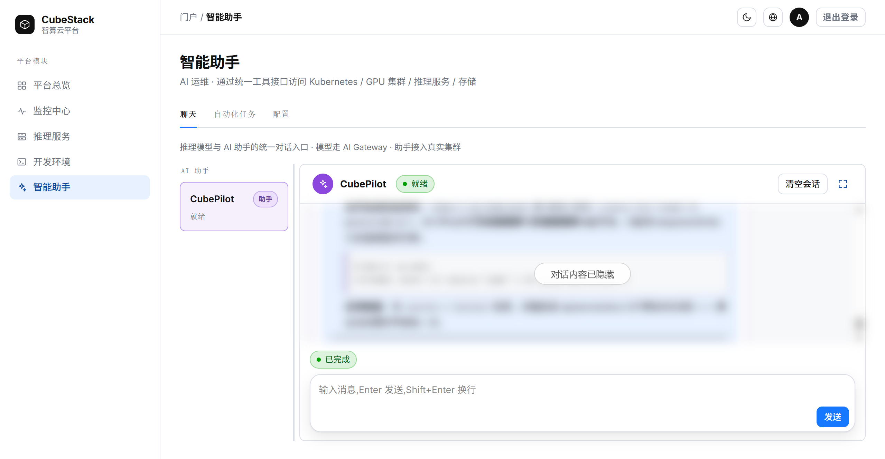
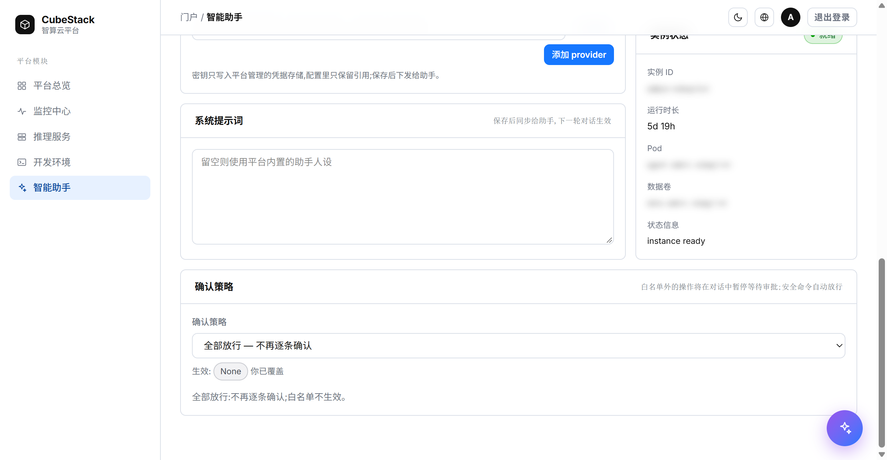
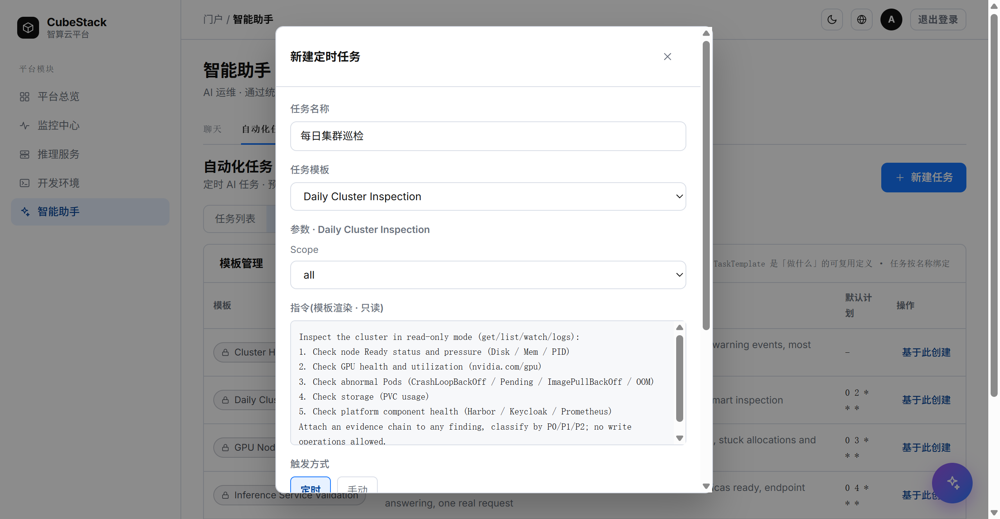
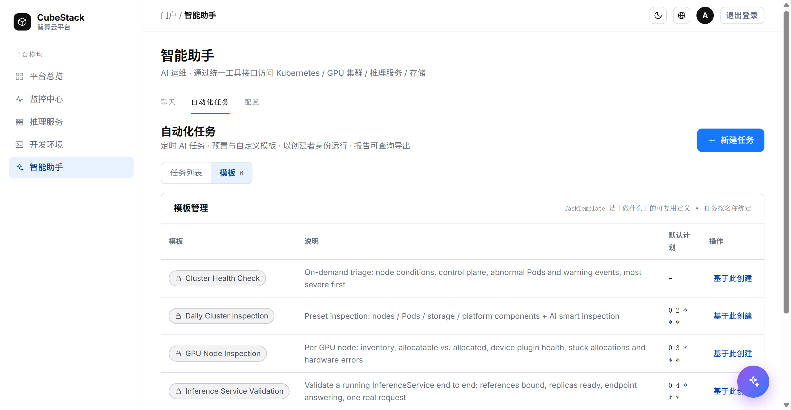
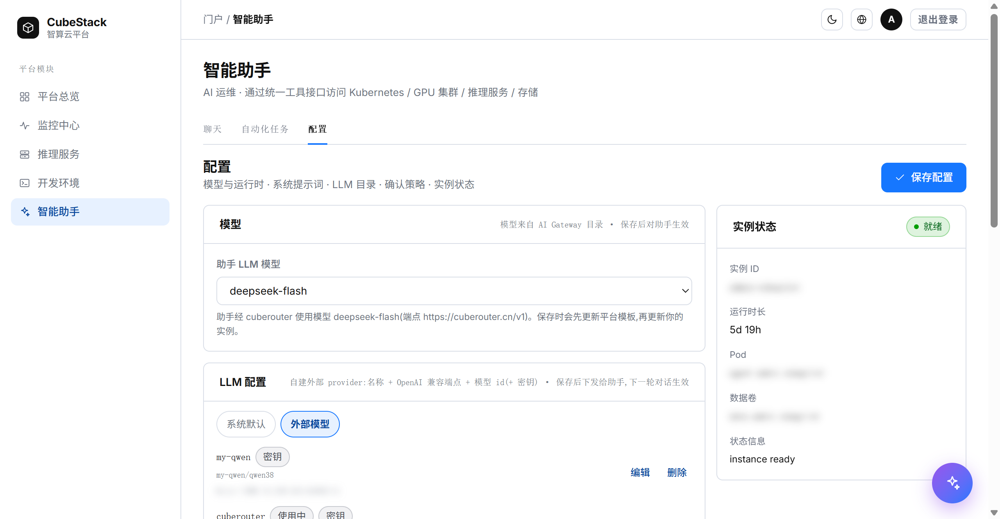

# CubePilot 用户指南

> 读者：CubeStack 平台的使用者。本文讲怎么用平台内置的智能助手 CubePilot：
> 第一次配置、日常对话、写操作审批、定时任务，以及模型和确认策略。
> 安装、部署与 API 接入见仓库根目录的 [README.md](../../README.md) 和
> [api.md](./api.md)。

CubePilot 是 CubeStack 平台内置的智能助手。它以你的账号身份访问集群，可以查询节点、
Pod、GPU、推理服务和存储的状态，也可以在你确认后执行运维操作；它还能按计划运行巡检
任务，把结果整理成报告。

## 1. 入口

登录 CubeStack 控制台，左侧导航选择「智能助手」。页面有三个 tab：

| tab | 用途 |
| --- | --- |
| 聊天 | 与推理模型或接入集群的 AI 助手对话 |
| 自动化任务 | 创建、运行、停用定时任务，查看和导出运行报告 |
| 配置 | 选择助手模型、编写系统提示词、配置 LLM provider、设置确认策略、查看实例状态 |

除了「智能助手」页里的 AI 助手对话界面本身，页面右下角都有浮窗
「CubeStack AI 智算 Copilot」。浮窗与聊天 tab 共用同一段对话：在浮窗里发的消息、
正在运行的回合、待处理的审批卡，切到聊天 tab 都能接着看到；浮窗里的
「在智能助手中打开」会跳到聊天 tab 继续同一段对话。

助手按用户隔离：每人有自己的助手实例、会话数据和运行身份，互不可见。

本文按 CubeStack 控制台里的「智能助手」页描述。单机安装自带的 Portal 提供等价的
聊天、任务与配置页面，布局和文案略有不同。

## 2. 首次使用

第一次使用时，助手还没有创建。按下面的顺序做一次即可：

1. 打开「配置」tab。
2. 在「模型」中选择「助手 LLM 模型」。下拉里的模型来自平台模板声明的 provider；
   如果一个都没有，先在「LLM 配置」中添加外部 provider（见第 6 节）。
3. 可选：填写「系统提示词」，让助手按你的偏好工作；留空则使用平台内置人设。
4. 点击「保存配置」。第一次保存会创建你的助手实例，页面提示
   「已保存 — 助手正在创建，首次启动约一分钟」。
5. 观察右侧「实例状态」：「创建中」会一直显示已等待时间，首次启动约一分钟，
   随后变为「就绪」。
6. 回到「聊天」tab，在左侧对象列表中选中「AI 助手」，发送第一条消息。

首次启动为什么慢：保存时会为你的账号生成访问集群的身份凭据，再拉起运行助手的 Pod。
创建完成后实例常驻，之后刷新页面、重新登录、切换页面都不需要重新创建。

如果「实例状态」显示「失败」，下方「状态信息」会给出原因；常见原因是模型不可用或
provider 端点不可达。

## 3. 聊天

*聊天页：左侧是对象列表，右侧是会话。截图中的对话内容已隐藏。*

### 3.1 对象列表

左侧对象列表有两类会话对象：

- **推理模型**：直接与 AI Gateway 中的模型对话，适合比较模型或做不涉及集群的一次性
  问答。回复不经过助手，也不会访问集群。输入框下方的「采样参数」可以调整
  temperature、top_p 和 max_tokens。
- **AI 助手**：接入集群的助手，是日常运维的主要入口。它能读取集群数据、执行
  `kubectl`，并在写操作前征求你的确认。助手内置了集群巡检、平台用法、kubectl
  资源操作等能力，不需要额外配置。

### 3.2 会话

- 每个用户固定一段助手会话。聊天 tab 和浮窗看到的是同一段；刷新页面会恢复历史，
  以及尚未处理的审批卡和问题卡。
- 输入框：Enter 发送，Shift+Enter 换行。
- 生成中状态行会依次显示「正在思考」「正在执行 N 个工具」「正在汇总工具结果」
  「正在生成回复」，结束后显示「已完成」「已停止」或「失败」。
- 工具调用以卡片展示，可以展开查看命令输出。
- 生成过程中可以点「停止」。停止只结束当前回合，已生成的内容保留。
- 离开页面不会中断正在运行的回合。回来时如果回合仍在运行，状态行显示「仍在运行…」；
  连接断开时显示「连接已断开 —— 这一轮可能仍在运行」，重新打开聊天或浮窗会重新接上。
- 「清空会话」删除服务端的对话记录，不可恢复；下一条消息会开始一段新会话。
  助手工作区里的文件不受影响。
- 聊天区可以展开（右上角图标）：展开后页面标题和 tab 行收起，对话占满窗口；
  再次点击还原。

## 4. 审批与提问

助手在两种情况下会暂停并等你：执行写操作前，以及需要你补充信息时。

### 4.1 写操作审批

助手准备执行写操作时，对话输入框上方会出现审批卡，显示要执行的命令、级别（write）
和原因。

- **批准**：只放行这一次，回合继续。
- **拒绝**：命令不执行，回合继续；助手会收到拒绝结果，通常改用只读方式或说明原因。
- **总是允许（加入白名单）**：放行这一次，并把该命令加入你的白名单，之后同类命令
  自动通过。只有「白名单」策略下才有这个按钮。
- 卡片上有倒计时，默认约 30 分钟；超时后本轮结束，需要重新发消息。
- 一回合里可能同时压着多条审批，每张卡独立处理。
- 命令较长时卡片内容可以滚动，批准和拒绝按钮始终可见。

### 4.2 提问

助手需要你补充信息时会弹出问题卡，例如让你选择命名空间、确认操作范围。

- 单选直接点选项；多选可以选多个；标有「其他…」的问题可以输入自己的答案。
- 点「提交」回答，点「忽略」让助手不再等待。
- 提交后卡片收起，对话里保留问答记录。
- 问题也有超时；超时后助手不再等待。

### 4.3 确认策略

在「配置 → 确认策略」中设置：

- **白名单**（默认）：只读命令自动放行，其余写操作逐条审批。「白名单」区域列出
  平台默认规则（只读命令，始终放行）和你添加的规则；可以按命令（可选参数正则）
  添加规则，也可以移除，或「恢复平台默认白名单」。
- **全部放行**：不再逐条确认，写操作直接执行。仅在明确信任助手时使用；此时白名单
  不生效。

策略默认继承模板，改动后显示「你已覆盖」。

*确认策略与生效状态。*

注意：定时任务不受这里约束，见「自动化任务」一节。

## 5. 自动化任务

「自动化任务」tab 分「任务列表」和「模板」两部分。任务列表只显示你创建的任务。

### 5.1 新建任务

点右上角「新建任务」：

1. 填写任务名称。
2. 选择「任务模板」，或选择「不使用模板（自由任务）」。平台预置了若干模板，例如
   `Daily Cluster Inspection`、`GPU Node Inspection`、`Inference Service Validation`；
   实际可用的模板以列表为准。
3. 选择模板后填写模板参数，右侧「指令」区会显示渲染后的完整指令；自由任务直接填写
   任务指令。
4. 选择「触发方式」：
   - **定时**：填写 5 段 Cron，按 UTC 执行；对话框会提示下一次执行时间。
   - **手动**：只在你点「立即运行」时执行。
5. 点「创建任务」。

*选择模板后，参数和渲染后的指令会实时显示。*

任务以你的身份运行：读写操作直接执行，没有二次确认；没有权限的操作会在执行时被
拒绝并标记在报告里。

### 5.2 运行与管理

- 「立即运行」手动触发一次，即使任务已停用也可以手动运行。
- 「停用」暂停定时触发，不影响历史报告和手动运行；「启用」恢复。
- 「删除」会连同历史报告一起删除，不可恢复。

### 5.3 报告

在任务列表中选中任务，右侧显示运行记录：

- 选择某次运行查看报告；报告是助手的真实输出。
- 运行中的报告显示「运行进行中，报告内容将在完成后显示」，完成后自动刷新。
- 「导出报告」下载 Markdown 文件。

### 5.4 模板

*平台提供的任务模板，可直接「基于此创建」。*

「模板」部分列出平台提供的模板、说明和默认计划；「基于此创建」会打开预填了模板的
新建对话框。

## 6. 配置

### 6.1 模型与系统提示词

- **助手 LLM 模型**：模型来自模板声明的 provider，引用格式是「provider 名/模型 id」。
  保存后对助手生效，下一轮对话开始使用新模型。
- **系统提示词**：追加在平台内置指令之后，用来告诉助手你的偏好、常用命名空间、
  报告格式等。留空使用平台内置人设。最长 20,000 字符。

保存配置后，模型和提示词的变更在下一轮对话生效，不需要重启实例。

### 6.2 LLM 配置

用于给助手添加模型来源：

- **系统默认**：平台 AI Gateway 提供的模型，只读。
- **外部模型**：自己的 OpenAI 兼容端点。填写 provider 名、端点、模型 id 和凭据：
  - provider 名同时是模型引用的前缀。不要使用 `qwen`、`deepseek`、`kimi` 等运行时
    已内置的 provider 名，否则离线环境下助手可能无法启动；页面会在输入时提示。
  - 端点填 API 根，例如 `https://api.example.com/v1`。
  - 模型 id 用逗号分隔；也可以点「拉取模型」从端点读取（需要先填 apiKey）。
  - 凭据二选一：apiKey，或勾选「公开（无需密钥）」。
- 保存后 provider 下发给助手，新增的模型会出现在「模型」下拉中。
- 可以编辑或删除 provider；删除时它的密钥一并删除。仍有实例选择它的模型时不能删除，
  需要先改选模型。
- 密钥只写入平台管理的凭据存储，配置里只保留引用。

### 6.3 实例状态

*配置页：模型、LLM 配置和实例状态。截图中的内部端点和实例标识已模糊处理。*

显示实例 ID、运行时长、Pod、数据卷和状态信息。模型不可用时，这里会显示具体原因
（例如尚未配置可用模型）；助手只有处于「就绪」才可用。

## 7. 常见问题

| 现象 | 处理 |
| --- | --- |
| 提示「助手还没创建」 | 到「配置」选择模型并保存，首次启动约一分钟 |
| 「创建中」超过几分钟 | 查看「实例状态 → 状态信息」；集群资源不足时助手 Pod 可能一直等待调度 |
| 实例「失败」 | 按状态信息排查，常见是模型不可用或 provider 端点不可达 |
| 「模型」下拉为空 | 模板没有声明可用 provider，或 AI Gateway 不可达；在「LLM 配置」添加外部 provider |
| 回复停在「正在思考」 | 先看状态行；如果是连接断开，重新打开聊天或浮窗会接上 |
| 写操作没有等审批就执行 | 确认策略可能是「全部放行」；如果已是「白名单」，该命令可能匹配了白名单规则——平台默认的只读规则，或你之前点过「总是允许」记住的命令。先检查并移除「你的规则」里匹配的规则；「总是允许」记住的授权不在列表里，需要管理员撤销 |
| 定时任务没有按预期时间运行 | 计划使用 UTC；确认任务未停用、上次运行未失败 |
| 报告为空或失败 | 打开对应运行记录查看；失败通常是被集群权限拒绝 |

## 8. 能力与数据边界

- 助手通过你账号的身份访问集群，能读什么、能改什么由平台授予的权限决定；没有权限的
  请求会被集群拒绝。
- 读取操作直接执行；写操作是否暂停取决于确认策略。
- 定时任务以创建者身份直接运行，不受确认策略约束。
- 每个用户的会话、记忆和工作区文件保存在各自的数据卷中；Pod 重建后仍然保留。
- 「清空会话」只删除对话记录。删除助手实例会删除它的数据卷（PVC）；底层存储是否回收
  取决于存储类的回收策略。这一步由平台管理员操作。
